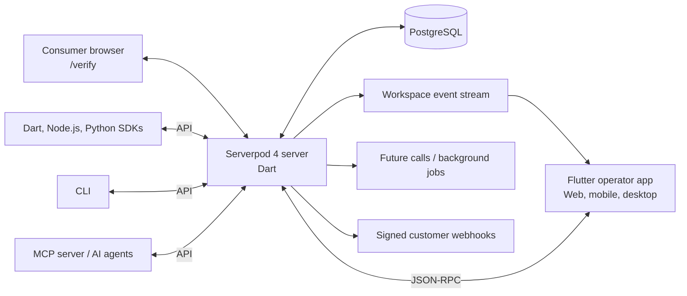

# FauxShield

**Anti-counterfeit infrastructure for physical products.** Give every product unit a verifiable identity, detect suspicious activity as it happens, and give teams the evidence and tools to respond.

FauxShield assigns each physical unit a signed QR identity and a unique packaging PIN. A shopper can verify a product from a browser—without installing an app, creating an account, or using special hardware. Behind the consumer-facing verdict, brands get unit-level traceability, live fraud signals, an auditable investigation trail, and workflows for alerts and recalls.

The platform is built with **Serverpod 4, Dart, and Flutter**. One Serverpod backend serves the API, database, streaming events, background jobs, public web pages, and developer documentation.

## Try FauxShield

| Resource | Link |
| --- | --- |
| Live platform | [fauxshield.serverpod.space](https://fauxshield.serverpod.space/) |
| Consumer verification | [Verify a product](https://fauxshield.serverpod.space/verify) |
| Operator command center | [Open the app](https://fauxshield.serverpod.space/app) |
| Developer documentation | [API, SDK, CLI, and MCP docs](https://fauxshield.serverpod.space/docs) |
| API host | `https://fauxshield.api.serverpod.space` |


## Contents

- [Why FauxShield](#why-fauxshield)
- [How it works](#how-it-works)
- [Features](#features)
- [Architecture](#architecture)
- [How FauxShield uses Serverpod](#how-fauxshield-uses-serverpod)
- [Getting started locally](#getting-started-locally)
- [Developer platform](#developer-platform)
- [Testing and quality checks](#testing-and-quality-checks)
- [Deploy to Serverpod Cloud](#deploy-to-serverpod-cloud)
- [Repository layout](#repository-layout)
- [Security and deployment notes](#security-and-deployment-notes)
- [License](#license)

## Why FauxShield

Counterfeiting can cause more than lost sales. In medicines, agricultural inputs, food, cosmetics, electronics, and vehicle parts, a fake product can damage health, threaten livelihoods, and undermine trust in legitimate brands.

A few indicators show the scale of the problem:

- **Medical products:** The World Health Organization estimates that more than one in ten medicines in low- and middle-income countries are substandard or falsified. [WHO: Substandard and falsified medical products](https://www.who.int/health-topics/substandard-and-falsified-medical-products/)
- **Agricultural inputs:** An Access to Seeds Foundation report cites an estimate from Uganda's National Bureau of Standards that around 30% of seed on the Ugandan market is fake. This is a country-specific estimate, not an estimate for all of Africa. [Access to Seeds Foundation: Counterfeit seed](https://www.accesstoseeds.org/index/eastern-southern-africa/key-findings/counterfeit-seed/)
- **International trade:** The OECD and EUIPO estimated that international trade in counterfeit and pirated products reached as much as **US$464 billion in 2019**, or 2.5% of world trade. This estimate excludes counterfeit goods produced and consumed domestically and pirated digital products distributed online. [OECD/EUIPO: Global Trade in Fakes](https://www.oecd.org/en/publications/global-trade-in-fakes_74c81154-en.html)

These estimates measure different things and should not be treated as directly comparable. Together, they illustrate why product verification needs to be accessible to consumers and useful to the organizations responsible for product integrity.

### Why common approaches fall short

| Approach | Limitation |
| --- | --- |
| Static QR codes | A code can be copied. Without unit-level controls and monitoring, a copied label can appear just as valid as the original. |
| SMS verification | Can introduce cost and friction at scale, and may leave brands without the investigation context they need. |
| Holograms and specialist tags | Add packaging or inspection costs and do not, by themselves, provide a live evidence and response workflow. |

The gap is not simply the lack of a label. It is the lack of a reliable connection between a specific physical unit, its batch and distribution context, verification activity, and the actions a brand takes when something looks wrong.

**FauxShield combines product identity, verification, fraud intelligence, and response in one platform.** The QR code is the entry point—not the whole security model.

## How it works

1. **Create product identities.** Organize products into batches and generate unique, signed identities for individual units.
2. **Label each unit.** Export QR identity data for packaging and associate a unique packaging PIN with each unit.
3. **Verify at the point of sale.** A consumer opens the verification page, enters the token and PIN, and receives a verdict without creating an account.
4. **Evaluate the event.** FauxShield applies workspace policies and checks for suspicious patterns, including geographically implausible reuse and repeated PIN failures.
5. **Investigate and respond.** Alerts include evidence; teams can review activity, manage recalls, and send signed event webhooks to other systems.

## Features

### 1. Product and unit serialization

- **Product → batch → unit model:** Maintain a traceable relationship between a product, its manufacturing batch, and each serialized unit.
- **Per-unit identity:** Each unit receives a random 128-bit QR token and an HMAC-SHA256 signature over that token.
- **Packaging PIN:** Each unit also receives a unique six-digit PIN.
- **Protected PIN storage:** PINs are stored as PBKDF2 hashes for verification and AES-GCM ciphertext for controlled retrieval. Each PIN reveal is recorded in the audit log.
- **Idempotent generation:** Retrying `generateIdentities` returns the original result rather than creating duplicate identities—for example, when a large generation request is retried.
- **Print and system integration:** Export identities in CSV or TSV format and use operation-scoped API keys for machine access.

### 2. Consumer and operator verification

- **Public verification page:** The `/verify` page supports token and PIN entry, returns a verdict, and lets consumers report a product.
- **Operator verification:** The Flutter app includes the verification flow and a one-tap **Demo unit** action.
- **Replay protection:** Verification sessions are bound to a device fingerprint and use a sliding 15-minute expiry window.
- **Controlled presentation:** Only an allow-listed presentation is returned to the client, rather than exposing internal records wholesale.

### 3. Real-time fraud detection

FauxShield evaluates six fraud checks for each scan, within a bounded time budget and against workspace policy:

1. **Clone detection** — the same token is presented in distant locations.
2. **Velocity anomalies** — scan frequency or volume is suspicious.
3. **PIN attacks** — repeated or suspicious PIN attempts are detected.
4. **Batch duplication** — activity suggests duplicated identities within a batch.
5. **Distributor leakage** — patterns suggest product leakage from an expected channel.
6. **Restricted-country scans** — activity originates from countries restricted by the workspace policy.

Two additional protections operate in the write path: PIN lockout after repeated failures and reconciliation of offline backfill. Together, these are the eight checks and protections described by the current implementation.

- Alerts are deduplicated and scored; policy can automatically lock a unit.
- Scans, signals, alerts, recalls, offline ingestion, and simulation progress are published to a Serverpod streaming channel and appear in the operator app's live feed.
- Signed webhooks use a `t=…,v1=…` HMAC scheme and support retries, backoff, delivery inspection, and manual redelivery.

### 4. Attack simulations

Use four scripted simulations to exercise the same pipeline used by real verification events:

- Clone attack
- PIN brute force
- Scan burst
- Grey-market leak

Simulations create real sessions, signals, and alerts, allowing teams to practise their response against the live event feed. They can run inline, step by step, or at a paced interval through a background future call.

### 5. Offline inspection

- Inspectors can queue scans on-device while offline.
- Serverpod's offline-sync layer mirrors synced records to the server.
- A recurring future call turns synced rows into authoritative verification sessions and writes the resulting verdict back to the device records.
- A direct batch-ingest endpoint is also available for devices that reconnect and need immediate verdicts.

### 6. Operations and governance

- **Analytics:** Verification trends, outcome mix, top countries, alert counts, and daily rollups.
- **Team access:** Owner, admin, member, and viewer roles, governed by 22 permissions.
- **Invitations:** One-time invitation codes.
- **Auditability:** An audit log for sensitive operations and investigation activity.
- **Administration:** Notification preferences, API keys, and webhook management.
- **Demo workspace:** One-click seed data containing a brand, products, batches, 240 serialized units, verification events, a recall, consumer reports, and two simulations.

## Architecture

The operator app and public consumer flow use the same backend services. Business rules are centralized in the server rather than separately implemented across the web app, SDKs, CLI, or MCP server.



### Server responsibilities

- Typed API endpoints and generated protocol definitions
- Product, batch, identity, verification, fraud, alert, recall, and demo services
- Workspace authorization and API-key scope enforcement
- Live event streaming
- Background processing for webhook delivery, offline scan conversion, analytics rollups, maintenance, and paced simulations
- Server-rendered landing, features, pricing, about, documentation, and consumer verification pages
- PostgreSQL persistence and migrations

The server registers **17 routes**: 15 FauxShield endpoint classes under `lib/src/endpoints/` plus the `emailIdp` and `jwtRefresh` routes contributed by Serverpod authentication. The generated client, SDKs, and FauxShield API reference cover the 15 platform endpoints; the authentication routes are provided and documented by Serverpod.

## How FauxShield uses Serverpod

Serverpod is the foundation of the application—not just a database adapter. It supplies the typed protocol, authentication primitives, streaming, offline synchronization, background jobs, and server-side web routing.

| Serverpod capability | How FauxShield uses it | Where to look |
| --- | --- | --- |
| Endpoints and generated protocol | 15 endpoint classes with typed parameters, typed exceptions, and allow-listed presentation data. Clients share the same API definitions. | `lib/src/endpoints/`, `fauxshield_client/` |
| Models as schema | 84 `.spy.yaml` models and enums generate server classes, the Dart client, API reference data, and PostgreSQL schema. Model changes produce migrations for review. | `lib/src/models/`, `migrations/` |
| Authentication | Email identity provider, registration codes, password resets, and refresh tokens. Development codes are printed to the server console; staging/production email uses the configured Serverpod Cloud email service. | `lib/server.dart`, `lib/src/endpoints/verification_endpoint.dart` |
| Authorization | Workspace membership and role permissions are resolved server-side on every call. API keys have their own scopes and rate limits. | `lib/src/services/rbac.dart`, `api_key_service.dart` |
| Streaming | `watchWorkspace` opens a workspace-scoped method stream such as `workspace:<id>`. Events are pushed as they occur; the app reconnects and falls back to polling when the socket is unavailable. | `verification_endpoint.dart`, `fauxshield_flutter/lib/screens/live_feed_screen.dart` |
| Future calls | Recurring jobs process webhook delivery, offline scan conversion, daily rollups, and maintenance. A one-off future call can drive paced simulations. | `lib/src/future_calls/` |
| Offline sync | `OfflineScanRecord` uses `database: sync`. Synced rows are converted into policy-evaluated verification sessions, with verdicts written back to the relevant records. | `lib/src/models/`, `lib/src/services/offline_ingest_service.dart` |
| Database operations | Row-locked transactions protect PIN submission and identity minting; bulk update/delete, pagination, and aggregate queries support operations and analytics. | `lib/src/services/verification_service.dart`, `identity_service.dart` |
| Web server | Server-rendered WidgetRoutes and Mustache templates serve public pages, docs, and consumer verification from the same process as the API. | `lib/src/web/`, `web/templates/` |
| Configuration and project structure | Server, generated client, Flutter app, migrations, and Dockerfile are maintained in one Serverpod workspace, with environment-specific configuration. | `pubspec.yaml`, `config/`, `Dockerfile` |
| Testing | Tests use `serverpod_test` and Serverpod's embedded PostgreSQL test setup. The documented local test flow does not require a separate Docker database. | `test/`, `config/test.yaml` |
| Deployment | Serverpod Cloud builds the server, provisions PostgreSQL, applies migrations, and hosts the API and web routes. The Dockerfile can also be used in other environments. | `docs/DEPLOYMENT.md` |

Two design choices follow from this structure:

- **The API is the product.** The operator app, consumer page, SDKs, CLI, and MCP server all use the same server-side capabilities.
- **Domain logic lives in one place.** Endpoints validate requests, resolve workspace identity and permissions, and delegate to services such as the verification service, fraud engine, alert service, recall service, webhook handling, and demo seeder. Simulations therefore exercise the same pipeline as real activity.

## Getting started locally

### Prerequisites

- Dart SDK **3.12.2 or later**. The project was built with Flutter 3.47.6 / Dart 3.13.5.
- Serverpod CLI available on your `PATH`.
- Flutter SDK only if you want to rebuild or run the operator app separately. A prebuilt web bundle is included under `fauxshield_server/web/app`.
- Docker is not required for the documented local development flow; Serverpod uses embedded PostgreSQL.

### 1. Start the server

From the repository root:

```bash
cd fauxshield_server
serverpod start
```

The Serverpod CLI starts the development database, applies pending migrations, and watches for changes. The first run creates the local data directory under `.serverpod/development/pgdata`.

Local URLs:

| Service | URL |
| --- | --- |
| API | `http://localhost:8080` |
| Insights | `http://localhost:8081` |
| Landing page | `http://localhost:8082/` |
| Consumer verification | `http://localhost:8082/verify` |
| Operator app | `http://localhost:8082/app` |
| Developer docs | `http://localhost:8082/docs` |

Press `Q` in the Serverpod CLI to stop the server.

For a plain foreground run, such as in a headless environment:

```bash
cd fauxshield_server
dart pub get
dart run bin/main.dart --mode development --apply-migrations
```

Use `--apply-migrations` on the first run or after a model change. Development secrets are in `fauxshield_server/config/passwords.yaml`; these values are for local development and must be replaced before a real deployment.

### 2. Open the operator app

Open the prebuilt app at [http://localhost:8082/app](http://localhost:8082/app), or run Flutter with hot reload:

```bash
cd fauxshield_flutter
flutter pub get
flutter run -d chrome
# Or run on a supported mobile or desktop target:
flutter run
```

Create an account with an email address and password, then select **Open demo workspace**. The demo workspace includes the sample products, batches, units, verifications, recall, alerts, and simulations needed to explore the interface.

**Where is my email verification code?** In development, no email is sent. The code appears in the server console after registration, in a message similar to:

```text
Registration code for you@brand.test: <verification-code>
```

Copy it into the app's verification step. When started with the Serverpod CLI, the same code may appear in a popup alert and be copied to the clipboard. Password-reset codes work the same way. Real emails are sent in staging/production run modes through the email service configured in `fauxshield_server/lib/server.dart`.

### 3. Try consumer verification

In the operator app, open **Verify a product** and select **Demo unit** to load a demo token. Enter its packaging PIN to submit a real verification through the platform pipeline.

To test the public consumer experience, copy a unit token and PIN from the catalog, then open:

```text
http://localhost:8082/verify?t=<token>
```

Enter the PIN on that page and watch the resulting scan appear in the operator app's live feed.

### 4. Rebuild the Flutter web app (optional)

A prebuilt web bundle is included, so this step is only needed after changing the Flutter app:

```bash
cd fauxshield_flutter
flutter build web --release --base-href /app/
cp -r build/web/. ../fauxshield_server/web/app/
```

The workspace uses a one-line patched copy of `sqlite_async` under `third_party/` so `dart2js` can compile the client-side database dependency. See `third_party/sqlite_async/README_GUARD.md` before changing that dependency.

### 5. Use the CLI

The CLI is a Dart console client that uses the same JSON-RPC API. It does not require the Flutter runtime or a browser.

Install it:

```bash
dart pub global activate fauxshield_cli
```

Example commands:

```bash
fauxshield auth login --email you@brand.test --password '<your password>'
fauxshield auth whoami
fauxshield products list
fauxshield batches list
fauxshield identities list --page-size 10
fauxshield alerts list --severity critical
fauxshield alerts show --alert <uuid>

# Verify a product from the terminal:
fauxshield verify --token <token> --pin <pin>
```

The CLI includes these command groups: `auth`, `workspace`, `products`, `batches`, `identities`, `alerts`, `verifications`, `recalls`, `simulations`, `analytics`, `audit`, `team`, `keys`, `webhooks`, `notifications`, `offline`, `demo`, and `verify`.

Every command supports `--json` for scripting. For automation, use an API key with only the scopes required by the job:

```bash
fauxshield keys create --label ci --scopes productsRead,batchesRead,analyticsRead
fauxshield auth login --api-key fs_live_...
# Or provide FAUXSHIELD_API_KEY in the environment.
```

Creating keys is a signed-in session operation. PIN reveals, workspace settings changes, simulations, and key management also require a signed-in person; other operations can use appropriately scoped keys.

`FAUXSHIELD_URL`, `FAUXSHIELD_API_KEY`, `FAUXSHIELD_TOKEN`, and `FAUXSHIELD_PASSWORD` can override stored configuration for unattended use, including CI. Run `fauxshield --help` for the full command list and see [`fauxshield_cli/README.md`](fauxshield_cli/README.md) for the command-by-command reference.

### 6. Connect an AI agent with MCP

The `fauxshield_mcp` package exposes platform capabilities as Model Context Protocol tools. MCP-compatible clients can read the fraud queue and retrieve evidence; with appropriately scoped write credentials, they can also work with alerts and recalls. Actions remain attributable in the audit log.

Install the server:

```bash
dart pub global activate fauxshield_mcp
```

Example MCP configuration:

```json
{
  "mcpServers": {
    "fauxshield": {
      "command": "fauxshield-mcp",
      "env": {
        "FAUXSHIELD_URL": "https://fauxshield.api.serverpod.space",
        "FAUXSHIELD_API_KEY": "fs_live_...",
        "FAUXSHIELD_READ_ONLY": "true"
      }
    }
  }
}
```

Set `FAUXSHIELD_READ_ONLY` to `true` when the agent should only read data. Only grant write-capable credentials to agents and workflows that need them. See [`fauxshield_mcp/README.md`](fauxshield_mcp/README.md) for the available tools and client configuration examples.

## Developer platform

FauxShield publishes several clients for the same API. The hosted developer portal currently includes a 42-page documentation site with a persistent sidebar, full-text search, generated API reference, SDK guides, CLI and MCP references, and task-oriented guides.

The reference is generated from the machine-readable contract in `fauxshield_contract/`. Endpoint, model, and enum pages are generated from that contract, and CI checks that the reference stays aligned with the implementation.

### Available clients

| Client | Install | Default API host |
| --- | --- | --- |
| Dart SDK — [`fauxshield_client`](https://pub.dev/packages/fauxshield_client) | `dart pub add fauxshield_client` | Supplied by the caller; the app reads it from `config.json` |
| Node.js SDK — [`fauxshield`](https://www.npmjs.com/package/fauxshield) | `npm install fauxshield` | `https://fauxshield.api.serverpod.space` |
| Python SDK — [`fauxshield-sdk`](https://pypi.org/project/fauxshield-sdk/) | `pip install fauxshield-sdk` | `https://fauxshield.api.serverpod.space` |
| CLI — [`fauxshield_cli`](https://pub.dev/packages/fauxshield_cli) | `dart pub global activate fauxshield_cli` | `https://fauxshield.api.serverpod.space` |
| MCP server — [`fauxshield_mcp`](https://pub.dev/packages/fauxshield_mcp) | `dart pub global activate fauxshield_mcp` | `https://fauxshield.api.serverpod.space` |

For detailed installation, authentication, API usage, SDK patterns, CLI commands, and MCP client setup, start with the [developer documentation](https://fauxshield.serverpod.space/docs). Package-level references are also maintained in [`fauxshield_cli/README.md`](fauxshield_cli/README.md) and [`fauxshield_mcp/README.md`](fauxshield_mcp/README.md).

### API and client parity

Run the parity check from the repository root:

```bash
python tools/check_parity.py
```

The current check reports coverage for **86 of 86 methods** and **76 of 76 models and enums** across the client contract. It also checks that SDKs default to the hosted API. These counts describe the current generated contract and should be refreshed when the API changes.

See [`docs/DEVELOPER_PLATFORM.md`](docs/DEVELOPER_PLATFORM.md) for the platform audit, architecture decisions, verification results, and remaining authorization work.

### Web entry points

When the local server is running on port `8082`, these pages are available:

| Page | Purpose | Local URL |
| --- | --- | --- |
| Landing | Live platform stats and demo product code | [http://localhost:8082/](http://localhost:8082/) |
| Features | Product capabilities | [http://localhost:8082/features](http://localhost:8082/features) |
| Pricing | Deployment options | [http://localhost:8082/pricing](http://localhost:8082/pricing) |
| About | Project context and implementation | [http://localhost:8082/about](http://localhost:8082/about) |
| Documentation | Concepts, API reference, SDK, CLI, and MCP guides | [http://localhost:8082/docs](http://localhost:8082/docs) |
| Consumer verification | Token, PIN, verdict, and product reporting | [http://localhost:8082/verify](http://localhost:8082/verify) |
| Operator app | Flutter command center | [http://localhost:8082/app](http://localhost:8082/app) |
| API | Serverpod JSON-RPC API | [http://localhost:8080](http://localhost:8080) |
| Insights | Serverpod Insights | [http://localhost:8081](http://localhost:8081) |

Public product and documentation pages use a **Dashboard** action that opens `/app`; the operator app directs visitors without a session to its sign-in screen. The consumer `/verify` page is designed as a separate shopper flow and does not route consumers into the operator interface.

## Testing and quality checks

Run the server suite:

```bash
cd fauxshield_server
dart test
```

The server suite covers core cryptography (HMAC, PBKDF2, and AES-GCM), verification outcomes, replay protection, PIN lockout, fraud signals and alert evidence, recalls, API-key authentication, product recycle-bin behavior, product-image storage, and demo seeding. The current repository reports **70 server tests**.

Run the CLI and MCP tests:

```bash
cd fauxshield_cli && dart test
cd fauxshield_mcp && dart test
```

The current client suites report **13 CLI tests** and **26 MCP tests**, including version parity, exit codes, API-key handling, configuration, MCP tool coverage, read-only enforcement, and the stdio handshake.

Static analysis commands:

```bash
dart analyze
flutter analyze
```

CI runs formatting, analysis, and tests on pushes through `.github/workflows/tests.yml`. Version tags publish the Node.js and Python SDKs through `.github/workflows/release-npm.yml` and `.github/workflows/release-python.yml`. The Dart packages (`fauxshield_client`, `fauxshield_cli`, and `fauxshield_mcp`) are published to pub.dev with `dart pub publish`.

## Deploy to Serverpod Cloud

The repository includes a Dockerfile, production configuration, a prebuilt Flutter web bundle, and database migrations under `fauxshield_server/`.

1. Authenticate with Serverpod Cloud:

   ```bash
   serverpod cloud auth login
   ```

2. From the server directory, launch a cloud project. Follow the prompts to provision PostgreSQL and create the service URLs:

   ```bash
   cd fauxshield_server
   serverpod cloud launch
   ```

3. Deploy subsequent changes:

   ```bash
   serverpod cloud deploy
   ```

4. Configure the required secrets using values created for the target environment:

   ```bash
   serverpod cloud password set hmacSecretKey
   serverpod cloud password set pinEncryptionKey
   serverpod cloud password set webhookEncryptionKey
   serverpod cloud password set demoSeedSecret
   ```

5. Check deployment status and logs:

   ```bash
   serverpod cloud status
   serverpod cloud log
   ```

Serverpod Cloud builds the server, provisions PostgreSQL, applies migrations, and serves the API and web entry points. See [`docs/DEPLOYMENT.md`](docs/DEPLOYMENT.md) for the full deployment guide and pre-flight checklist.

## Repository layout

The repository root is a Dart workspace containing the Serverpod server, generated client, Flutter app, CLI, and MCP server.

```text
fauxshield/
├── fauxshield_server/             # Serverpod 4 backend and web routes
│   ├── lib/
│   │   ├── server.dart            # Startup, auth, routes, recurring tasks
│   │   └── src/
│   │       ├── models/            # .spy.yaml models and enums
│   │       ├── core/              # Crypto, constants, geo, webhook signing
│   │       ├── services/          # Verification, fraud, alerts, recalls, demo
│   │       ├── endpoints/         # 15 platform endpoint classes
│   │       ├── future_calls/      # Recurring and paced background jobs
│   │       └── web/               # Landing, docs, consumer verification
│   ├── web/                       # Templates, CSS, prebuilt Flutter bundle
│   ├── migrations/                # Database migrations
│   └── test/                      # Unit and integration tests
├── fauxshield_flutter/            # Flutter operator command center
│   └── lib/
│       ├── screens/               # Dashboard, feed, alerts, catalog, etc.
│       ├── app/                   # Theme and workspace state
│       ├── widgets/               # Shared UI components
│       ├── utils/                 # Shared utilities
│       └── main.dart
├── fauxshield_cli/                # Dart command-line client
│   ├── bin/fauxshield.dart        # CLI entry point
│   ├── lib/src/commands/          # Command groups
│   └── README.md                  # CLI usage and command reference
├── fauxshield_mcp/                # MCP server for AI-agent integrations
│   ├── bin/fauxshield_mcp.dart    # MCP stdio entry point
│   ├── lib/src/tools/             # Catalog, operations, response tools
│   └── README.md                  # MCP setup and available tools
├── fauxshield_client/             # Generated Dart client (do not edit manually)
├── fauxshield_contract/           # Machine-readable API contract
├── third_party/sqlite_async/      # Web-build compatibility patch
├── docs/                          # Deployment guide and demo script
├── tools/                         # API/client parity checks
├── .github/workflows/             # CI and SDK release workflows
└── AGENTS.md                      # Repository notes for coding agents
```

## Security and deployment notes

- **Replace development secrets before deployment.** Rotate the values in `config/passwords.yaml` for the deployed environment and configure the secrets through the deployment platform.
- **Use least-privilege API keys.** Create keys with only the scopes needed by a script, integration, or agent.
- **Treat PIN reveals as sensitive operations.** They are auditable and should be restricted to trusted, authenticated operators.
- **Keep MCP read-only unless writes are required.** Set `FAUXSHIELD_READ_ONLY=true` and provide read-scoped credentials for agents that do not need to change records.
- **Review production configuration.** Before using the platform with real product identities or customer data, follow `docs/DEPLOYMENT.md` and validate the target environment's email, database, cryptographic secrets, webhook configuration, and access policy.

## License

FauxShield is licensed under the MIT License. See [`LICENSE`](LICENSE).
